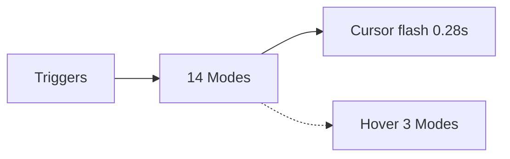

# SF Symbols & Action Mapping

Reference for the visual language of MCSC: every SF Symbol the app renders, the
action it represents, and exactly where it is triggered. Use this document when
extending the feedback system or auditing the UI.

---

## Overview: the two overlay systems

MCSC renders symbols in two distinct places, both data-driven:

| System | File | Anchoring | Interactive | Lifecycle |
|---|---|---|---|---|
| `CursorFeedbackOverlay` | `../MCSC/Views/CursorFeedbackOverlay.swift` | Mouse cursor | No — ignores all mouse events | Transient flash (~0.28 s), auto-retracts |
| `PreviewCloseButtonOverlay` | `../MCSC/Views/PreviewCloseButtonOverlay.swift` | Top-left vertex of a Mission Control window preview | Yes — clickable hover button | Persistent while hovering the window |

- **Cursor feedback** plays *before* the underlying (blocking AX) action runs so
  the flash commits on the run loop before the action starves it.
- **Hover button** changes its action/symbol dynamically as the user holds
  modifier keys (see [§ 2](#2-hover-button-symbols)).

---

## 1. Cursor feedback symbols — `CursorFeedbackMode`

There are **20** modes. Each mode is a small data descriptor: SF Symbol name,
accessibility label, tint palette, entry animation style, and an optional base
outline symbol that morphs into the filled glyph.

| Mode | SF Symbol | Base symbol | Accessibility label | Palette | Entry style |
|---|---|---|---|---|---|
| `.close` | `xmark.circle.fill` | — | Close Window | System multicolor (red X) | `bouncePop` |
| `.minimize` | `minus.circle.fill` | `minus.circle` (white\*\*) | Minimize Window | Black + system yellow | `shrinkDown` |
| `.quit` | `xmark.circle.fill` | — | Force Quit | Black → purple gradient | `bouncePop` |
| `.hide` | `eye.slash.circle.fill` | `eye.slash.circle` (white\*\*) | Hide Application | Black + system yellow | `shrinkDown` |
| `.eject` | `eject.circle.fill` | `eject.circle` | Eject Volume | White + systemRed (`[.white, .systemRed]`) | `bouncePop` |
| `.almost` | `inset.filled.rectangle` | `rectangle` | Almost Maximize Window | Accent (`controlAccentColor`) | `pulseExpand` |
| `.reasonable` | `inset.filled.center.rectangle` | `rectangle` | Small and Center | Accent (`controlAccentColor`) | `pulseExpand` |
| `.makeSmaller` | `arrow.up.right.and.arrow.down.left.rectangle` | — | Make Smaller Window | Accent (`controlAccentColor`) | `shrinkDown` |
| `.maximize` | `rectangle.fill` | `rectangle` | Maximize Window | Accent (`controlAccentColor`) | `pulseExpand` |
| `.closeTab` | `xmark.rectangle.fill` | — | Close Tab | System multicolor (red X) | `wiggle` |
| `.reopenTab` | `plus.rectangle.fill` | — | Reopen Tab | Black + system green (`[.black, .systemGreen]` at 100%) | `wiggle` |
| `.newWindow` | `rectangle.badge.plus` | — | New Window | System green | `bouncePop` |
| `.newTab` | `plus.rectangle.on.rectangle` | `plus.rectangle.on.rectangle` | New Tab | System green | `wiggle` |
| `.fullscreen` | `arrow.down.left.and.arrow.up.right.circle.fill` | — | Toggle Fullscreen | Black + system green (`[.black, .systemGreen]`) — same as `PreviewCloseButtonOverlay.Mode.fullscreen` | `pulseExpand` |
| `.spaceRight` | `arrow.right.circle.fill` | `arrow.right.circle` | Move Window to Next Desktop | White + accent | `slideRight` |
| `.spaceLeft` | `arrow.left.circle.fill` | `arrow.left.circle` | Move Window to Previous Desktop | White + accent | `slideLeft` |
| `.unminimizeAll` | `arrow.up.square.fill` | `arrow.up.square` | Unminimize | Black + system yellow | `pulseExpand` |
| `.command` | `command.circle.fill` | `command.circle` | Command Modifier | White + accent | `pulseExpand` |
| `.leftCycleSnap` | `rectangle.lefthalf.inset.filled.arrow.left` | `rectangle` | Left Cycle Snap | Accent | `pulseExpand` |
| `.rightCycleSnap` | `rectangle.righthalf.inset.filled.arrow.right` | `rectangle` | Right Cycle Snap | Accent | `pulseExpand` |

\* The entry style names the CoreAnimation keyframe curve played on entry
  (`bouncePop`, `wiggle`, `pulseExpand`, `shrinkDown`, `slideRight`,
  `slideLeft`) — see [§ 4](#4-animation-architecture--the-zero-overhead-coreanimation-engine).
\*\* Minimize and Hide paint their base glyph in plain white
  (`basePaletteColors = [.white]`) so the pre-morph state reads as neutral
  before filling into the black/yellow palette.

**Source:** the `CursorFeedbackMode` enum in `MCSC/Models/CursorFeedbackMode.swift`.
It lives in the Models layer because the descriptor is shared by the overlay
(the View that renders it), the animation engine, and the action routers.

---

## 2. Hover button symbols — `PreviewCloseButtonOverlay.Mode`

The Mission Control hover button has **5** modes, selected by held modifier
or by the hovered target:

| Held modifier | Mode | SF Symbol | Accessibility label | Palette | Action on click |
|---|---|---|---|---|---|
| *(none)* | `.close` | `xmark.circle.fill` | Close Window | System multicolor (red X) | Close window (AX close button) |
| `Option` | `.minimize` | `minus.circle.fill` | Minimize Window | Black + system yellow | Minimize window (AX minimize button) |
| `Command` | `.quit` | `xmark.circle.fill` | Force Quit | Black → purple gradient | Force terminate app |
| `Control` | `.fullscreen` | `arrow.down.left.and.arrow.up.right.circle.fill` | Toggle Fullscreen | Black + system green | Toggle fullscreen |
| *(none, but hovering an ejectable volume)* | `.eject` | `eject.circle.fill` | Eject Volume | White + system orange | Eject the volume |

> **Precedence:** `Cmd` → `Ctrl` → `Option` → ejectable volume → close. **Cmd wins** →
> `.quit`. This is enforced by `MissionControlHoverService.currentOverlayMode`.

**Source:** `PreviewCloseButtonOverlay.Mode` + `MissionControlHoverService`
(`currentOverlayMode`, `executeAction`).

---

## 3. Trigger → Symbol → Action mapping

All shortcuts and gestures below are scoped to **Mission Control only**.
Feedback mode = the symbol shown at the cursor when the trigger fires.

| Trigger | Feedback mode | SF Symbol | Action performed |
|---|---|---|---|
| `Cmd + W` | `.close` | `xmark.circle.fill` | Close tab (window) / close tab in app (Dock) |
| `Cmd + W` on ejectable Finder volume window\* | `.eject` | `eject.circle.fill` | Close Finder window + eject volume |
| `Cmd + Q` | `.quit` | `xmark.circle.fill` | Force quit app |
| `Cmd + Q` on ejectable Finder volume window\* | `.eject` | `eject.circle.fill` | Close Finder window + eject volume |
| `Cmd + M` | `.minimize` | `minus.circle.fill` | Minimize window |
| `Cmd + H` | `.hide` | `eye.slash.circle.fill` | Hide app |
| Pinch-in | `.close` | `xmark.circle.fill` | Close window / quit app |
| Pinch-in on ejectable Finder volume window\* | `.eject` | `eject.circle.fill` | Close Finder window + eject volume |
| `Cmd + Pinch-in` | `.quit` | `xmark.circle.fill` | Force quit app |
| `Cmd + Pinch-in` on ejectable Finder volume window\* | `.eject` | `eject.circle.fill` | Close Finder window + eject volume |
| Two-finger swipe left | `.closeTab` | `xmark.rectangle.fill` | Close tab |
| Swipe left on ejectable Finder volume window\* | `.eject` | `eject.circle.fill` | Close Finder window + eject volume |
| `Cmd + swipe left` | `.close` | `xmark.circle.fill` | Close window |
| Two-finger swipe right | `.reopenTab` | `plus.rectangle.fill` | Reopen closed tab |
| `Cmd + swipe right` (window) | `.newTab` | `plus.rectangle.on.rectangle` | New tab (`Cmd+T`) |
| `Cmd + swipe right` (Dock) | `.newWindow` | `rectangle.badge.plus` | New window |
| Two-finger swipe up | `.minimize` | `minus.circle.fill` | Minimize window |
| `Cmd + swipe up` | `.hide` | `eye.slash.circle.fill` | Hide app |
| Two-finger swipe down | `.maximize` | `rectangle.fill` | Fill screen |
| `Cmd + swipe down` | `.maximize` | `rectangle.fill` | Make larger (+33 %) |
| Two-finger double tap | `.reasonable` | `inset.filled.center.rectangle` | Reasonable size (60 %) |
| `Cmd + double tap` | `.almost` | `inset.filled.rectangle` | Almost maximize (90 %) |
| Pinch out | `.fullscreen` | `arrow.down.left.and.arrow.up.right.circle.fill` | Toggle fullscreen |
| `Cmd` + pinch out | `.newWindow` | `rectangle.badge.plus` | New window (`Cmd+N`) |
\* Eject applies only to Finder windows showing an ejectable/removable volume
(`MountedVolumeService.ejectableVolumePath != nil`, `bundleIdentifier == "com.apple.finder"`)
and only when `ShortcutConfiguration.isAutoEjectEnabled` is `true` (menu bar toggle, default on).
When disabled, those triggers fall through to their normal `.close`/`.quit`/`.closeTab` feedback.

**Source:** `ShortcutViewModel` (key-down and gesture paths in
`../MCSC/ViewModels/ShortcutViewModel.swift`) + `ShortcutActionRouter` / `GestureActionRouter` eject branches + `MountedVolumeService` + `EjectVolumeAction`.

#### Visual — Overlays

---

## 4. Animation Architecture & the Zero-Overhead CoreAnimation Engine

MCSC has exactly **one** animation engine: `OverlayAnimator` (`MCSC/Views/OverlayAnimator.swift`).
It is a stateless `enum` of `static` helpers, so no animator object is ever allocated and
the overlays hold no animation state.

- **Zero-Overhead CoreAnimation**: Direct `CALayer` hardware-accelerated keyframe animations
  and cross-fades.
- **Visual Fidelity**:
  - 0.16s morph cross-fade (`CATransition(.fade)`) from outline base symbol to filled glyph.
  - 5-point Apple spring bounce keyframe curve (0.72 ➔ 1.18 ➔ 0.94 ➔ 1.04 ➔ 1.0).
  - ±7° 6-point tab wiggle oscillation.
  - 1.20x pulse expansion for resize/window feedback.
  - Smooth scale-down dissolve retract.
- **Memory Profile**: **0 MB additional GPU/Metal footprint**. Measured idle footprint is
  **12.6 MB**, inside the 13 MB ceiling (`AGENTS.md`).

### Why there is no native symbol-effects path
Apple's SF Symbol Effects (`Symbols.framework` — `addSymbolEffect(.appear.byLayer)`,
`.disappear.byLayer`, `setSymbolImage(contentTransition: .replace.magic)`) decompose vector
layers through `NSSymbolEffectCoordinator` and allocate Metal/IOSurface texture pools of
~30–70 MB. That is incompatible with MCSC's zero-footprint mandate, so the engine avoids the
framework entirely: every visual effect is reproduced with plain CoreAnimation.

There is no quality switch, no strategy injection, and no restart-on-change plumbing — the
lightweight engine is the only engine.
